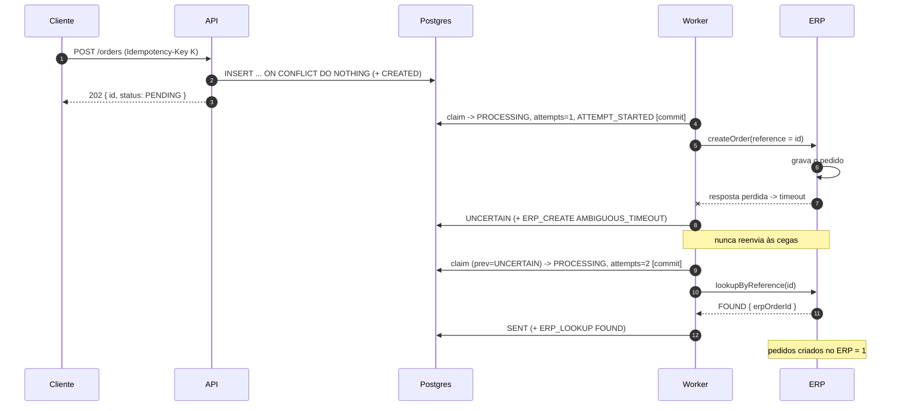

# Pedidos → ERP com idempotência e rastreabilidade

API pequena (Node.js + TypeScript, Fastify, PostgreSQL) que recebe pedidos de venda e os encaminha a um ERP externo simulado que pode falhar, ficar lento, dar timeout ou processar o pedido sem que a resposta chegue. Objetivo: **minimizar pedidos duplicados no ERP e saber o que aconteceu com cada solicitação**.

Enunciado: `docs/desafio.pdf`. Spec: `docs/specs/requirements.md` (requisitos EARS com IDs), `docs/specs/plan.md`, `docs/specs/tasks.md`, `docs/adr/`. Matriz requisito → teste: `docs/specs/traceability.md` (gerada).

## Como executar

Pré-requisitos: Node.js ≥ 22 e Docker (Compose v2).

```bash
npm ci
cp .env.example .env              # valores fictícios, só para uso local
docker compose up -d --wait       # Postgres 16 (cria orders_dev e orders_test)
npm run migrate                   # aplica as migrations no banco de dev
npm run dev                       # API + worker em http://localhost:3000
```

Testes e verificações:

```bash
npm test                          # suíte completa (unitários + integração contra Postgres real, banco orders_test)
npm run test:stress               # testes de concorrência 5x seguidas
npm run typecheck && npm run lint
npm run check:trace               # cada requisito [IMPLEMENTAR] tem teste; matriz atualizada
```

Exemplo:

```bash
curl -i -X POST http://localhost:3000/orders \
  -H 'content-type: application/json' -H 'idempotency-key: checkout-123' \
  -d '{"customer":{"name":"Maria Teste","document":"12345678901","email":"maria@example.test"},"items":[{"sku":"SKU-001","quantity":2,"unitPriceCents":1990}]}'
# 202 + Location: /orders/<id>. Repetir o mesmo comando: 200 + Idempotent-Replayed: true, mesmo id.

curl -s http://localhost:3000/orders/<id>               # status, tentativas, último erro e trilha de eventos
curl -i -X POST http://localhost:3000/orders/<id>/reprocess -H 'content-type: application/json' -d '{"reason":"ERP voltou"}'
```

## Arquitetura

Um processo Node com três papéis; o Postgres é fonte de verdade, fila e trilha de auditoria (ADR 0001).

```
cliente ──POST /orders──▶ Fastify ──INSERT ON CONFLICT──▶ orders + order_events
                                                         ▲   │ claim (SKIP LOCKED + lease)
                                                         │   ▼
                                       resultado guardado   Worker ──createOrder/lookup──▶ ErpClient (Fake)
```

- **API** (`src/http/`): valida com Zod estrito, grava pedido + evento `CREATED` numa instrução e responde `202` (ADR 0002). Não chama o ERP na requisição.
- **Worker** (`src/worker/`): reivindica um pedido com `FOR UPDATE SKIP LOCKED` + lease, commita, e só então chama o ERP, fora de transação. Toda finalização é `UPDATE ... WHERE status = 'PROCESSING' AND lease_token = $token`.
- **Trilha** (`order_events`): append-only; cada claim, chamada ao ERP (com `duration_ms`), transição e reprocess vira uma linha com `correlation_id`.
- **ERP** (`src/infra/erp/`): contrato tipado + classificação pura de respostas + `FakeErpClient` com cenários (`success`, `transient`, `permanent`, `timeout`, `processed_then_timeout`, `conflict_found`, `conflict_not_found`) e opção `honorsReference`.

Estados: `PENDING → PROCESSING → SENT | RETRY_SCHEDULED | FAILED | UNCERTAIN | NEEDS_REVIEW`; `FAILED → PENDING` e `NEEDS_REVIEW → UNCERTAIN` só por reprocess; `SENT` é terminal (plan §4).

## Estratégia

**Idempotência (ADR 0004).** `Idempotency-Key` obrigatória + `UNIQUE(idempotency_key)` + `INSERT ... ON CONFLICT DO NOTHING`, na mesma instrução que grava o `CREATED`. Sem `SELECT`-then-`INSERT`. Mesma chave e mesmo payload (hash SHA-256 do JSON canônico) → `200 Idempotent-Replayed` com o estado atual; payload diferente → `422`.

**Concorrência.** N `POST` simultâneos com a mesma chave: o banco serializa, 1 pedido. Dois workers: `SKIP LOCKED` entrega cada linha a um só. Worker que perdeu o lease: o `lease_token` (fencing token) faz o `UPDATE` dele afetar 0 linhas, e ele grava só um evento `LEASE_LOST`. Reprocess concorrente: um único `UPDATE ... WHERE status IN ('FAILED','NEEDS_REVIEW')` decide; 1 resposta `202`, as demais `409`.

**Falhas.**

| Resultado do ERP | O que fazemos |
|---|---|
| sucesso | `SENT` com `erp_order_id` |
| 4xx de negócio | `FAILED` / `ERP_REJECTED`, sem retry |
| 5xx, 408, 429, conexão recusada | `RETRY_SCHEDULED` com backoff exponencial + jitter; esgotou → `FAILED` / `RETRIES_EXHAUSTED` |
| timeout, 409 (conflito), lease vencido | **ambíguo**: `UNCERTAIN`, e a próxima tentativa **consulta o ERP pela referência antes** de qualquer reenvio |
| consulta indisponível | continua `UNCERTAIN`; esgotou → `NEEDS_REVIEW` / `RECONCILIATION_EXHAUSTED` |

A referência enviada ao ERP é sempre o `order.id`, a mesma em todas as tentativas.

### Diagrama: o ERP processa, mas a resposta se perde



**Logs e dados sensíveis.** pino estruturado; todo log de operação traz `correlationId`, `orderId`, `attempt`, `status`. Logs recebem só campos escalares escolhidos (nunca payload, body ou objeto de erro; erros viram `errName`/`errCode`). `redact` é rede de segurança. Mensagens do ERP são limpas de document/email/name e truncadas em 200 caracteres antes de ir para o banco. `GET /orders/:id` não devolve o payload.

## Implementado × proposta para produção

**Implementado** (todos os requisitos `[IMPLEMENTAR]`, cada um com teste; ver `docs/specs/traceability.md`): `POST /orders`, `GET /orders/:id`, `POST /orders/:id/reprocess`, `GET /health`; idempotência no banco; worker com lease, fencing token, backoff com jitter e reconciliação por consulta; máquina de estados guardada no SQL; trilha `order_events`; logs estruturados com redact e limpeza de mensagens do ERP; limites de entrada (32 KB, 415, Zod estrito); config validada por Zod; graceful shutdown.

**Proposta para produção** (não implementado, sem teste):
- REQ-IDEM-05: expirar chaves de idempotência e escopá-las por cliente autenticado.
- REQ-ERP-10: `HttpErpClient` real (timeout por `AbortSignal`, TLS/mTLS, segredos em secret manager), com o mesmo contrato e a mesma classificação.
- REQ-RETRY-09: alertas para pedidos parados em `NEEDS_REVIEW`/`UNCERTAIN`, conciliação em lote, reprocess restrito a papel operacional.
- REQ-OBS-06: métricas, tracing (OpenTelemetry) e trigger impedindo `UPDATE`/`DELETE` em `order_events`.
- REQ-SEC-05: autenticação/autorização, rate limiting, TLS, privilégio mínimo no banco, criptografia dos dados pessoais em repouso, retenção (LGPD), varredura de dependências.

## Garantias e limitações

A garantia contra duplicidade no ERP vem de (a) nunca reenviar após resultado ambíguo (timeout, conflito ou lease vencido) sem consultar o ERP antes, e (b) o ERP honrar a referência (P-01). Após 5xx o reenvio é direto (P-02, risco aceito).

**Qual teste prova o quê:**
- **Provam a nossa lógica (a)** — rodam com `honorsReference=false`, um ERP que **não** deduplica; se o código reenviasse, `createdCount` seria > 1:
  - `ambiguity.test.ts` › `processed_then_timeout with honorsReference=false: UNCERTAIN, then lookup FOUND -> SENT with createdCount 1 (Obr-5)`;
  - `ambiguity.test.ts` › `honorsReference=false + lookup unavailable: NEEDS_REVIEW without resending, createdCount 1 (Obr-9)` — com a consulta indisponível, o pedido termina em `NEEDS_REVIEW` com 1 criação. Uma mutação que trata `UNKNOWN` como `NOT_FOUND` quebra o teste (`expected 3 to be 1`).
- **Dependem da premissa do ERP (b)** — rodam com `honorsReference=true` (padrão): o mesmo teste Obr-5 com `honorsReference=true` e `fake-erp.test.ts` › `honorsReference=true (default) deduplicates by reference`. Neles `createdCount = 1` valeria mesmo se o código reenviasse, então **não** provam (a); mostram o comportamento do sistema quando P-01 vale.
- Todos os testes de reconciliação assumem que o ERP oferece consulta por referência (P-01); o fake a implementa.

Outras garantias: 1 pedido por `Idempotency-Key` sob concorrência (`concurrency-post.test.ts`); 1 worker por pedido (`concurrency-worker.test.ts`); `SENT` é terminal; toda transição tem evento na mesma instrução/transação.

### Revisão adversarial

| # | Risco | Tem teste? | O que foi feito | O que sobra |
|---|---|---|---|---|
| 1 | **Curinga do redact do pino** (`3e2843a`): `*.document` cobre exatamente um nível; `document` na raiz do objeto de log saía em claro. | Sim: `logger.test.ts` › `masks customer.document when logged directly`. | Achado pelo teste mínimo de redact; paths de nível raiz adicionados. | Nada específico além do risco 2. |
| 2 | **Redact só até o nível 2** (`x`, `*.x`, `*.*.x`). | Sim, nos níveis 0, 1 e 2: `logger.test.ts` › `masks document and email at depth 0, 1 and 2`. **Não há teste para nível ≥ 3, porque ele não é mascarado.** | Regra primária: nenhum log recebe objeto aninhado, só escalares (REQ-OBS-05); o Obr-8 (`observability.test.ts`) faz POST real com marcadores e varre toda a saída de log (request, worker, erro do ERP). | Um log futuro com objeto de 3+ níveis vazaria; depende de revisão de código e do Obr-8 cobrir o caminho. |
| 3 | **5xx/3xx com reenvio direto** (P-02, risco aceito): se o ERP efetivar e responder 5xx (ou 3xx a um POST), o reenvio sem consulta pode duplicar. | Parcial: `retry.test.ts` › `retries transient errors until success ... (Obr-4)` e `bounds out-of-contract 3xx responses by MAX_ATTEMPTS (P-02)` provam que o reenvio é limitado e leva a mesma referência. **Não há teste do cenário "ERP processou e devolveu 5xx"**: o fake não modela esse caso, pois é exatamente a premissa aceita. | Referência estável em toda chamada (com P-01, o ERP deduplica); `MAX_ATTEMPTS` limita os reenvios. | Duplicidade possível se o ERP não deduplicar. Para eliminar: consultar antes de todo reenvio (custo: uma chamada extra por retry). |
| 4 | **Lease vencido é ambíguo e `attempts > MAX_ATTEMPTS`**: o worker pode ter caído depois de o ERP receber o pedido; o claim incrementa `attempts` incondicionalmente. | Sim: `lease.test.ts` › `crash after the ERP processed the order: reclaim finds it and never re-sends` (consulta antes, 1 criação), `fencing token: ...` e `concurrency-lease-exhausted.test.ts` › `abandons an expired lease whose attempts are exhausted to NEEDS_REVIEW without calling the ERP` (`attempts = MAX + 1`, zero chamadas ao ERP). | Lease vencido = ambíguo (consulta primeiro); esgotado → `NEEDS_REVIEW`/`LEASE_EXPIRED` dentro da transação do claim; `attempts` conta claims, não chamadas ao ERP (decisão do gate F2). | `attempts` pode exceder `MAX_ATTEMPTS` em 1 (esperado, documentado). Um worker lento além do `LEASE_MS` gera uma chamada concorrente ao ERP; o fencing descarta o resultado dele, mas a chamada já foi feita (mitigado por `LEASE_MS` > soma dos timeouts, validado na config). |
| 5 | **ERP ecoa dados pessoais na mensagem de erro** (P-08). | Sim: `scrub.test.ts` (document formatado, caixa, mais longo primeiro, valor atravessando a posição 200) e `observability.test.ts` › `an ERP message echoing personal data reaches order_events truncated and without the values`. | Substituição por `[REDACTED]` antes do truncamento em 200; document só dígitos e formatado; email/name sem diferenciar caixa; name a partir de 4 caracteres. **Mitigação em profundidade, não garantia.** | Nomes com menos de 4 caracteres e ecos transformados (abreviados, mascarados, codificados) passam (P-08, risco aceito). |
| 6 | **Dependência da premissa P-01**: o ERP real precisa aceitar a referência externa e permitir consulta por ela (ou idempotency key). | Parcial: o fake implementa a premissa, e os testes com `honorsReference=false` provam que **o nosso lado** não reenvia sem consultar. **Não há teste contra o ERP real**, que não existe neste projeto. | Contrato `ErpClient` exige `lookupByReference`; sem resposta conclusiva, o pedido vai a `NEEDS_REVIEW` em vez de reenviar. | Se o ERP real não tiver consulta nem dedupe, todo timeout vira conciliação manual. É a primeira coisa a validar com o time do ERP. |

> `check:trace` verifica que existe ao menos um teste por requisito; não avalia a qualidade nem a suficiência desses testes

## Roteiro de 5 minutos (entrevista)

1. **(0:00–0:45) Problema.** O risco não é o erro, é o timeout em que o ERP processou. Exactly-once é impossível sem o ERP cooperar; o objetivo é nunca reenviar às cegas e ser auditável.
2. **(0:45–1:45) Fluxo.** `POST` → `INSERT ON CONFLICT` + `CREATED` numa instrução → `202`. Worker: claim com `SKIP LOCKED` + lease, commit, chama o ERP fora de transação, finaliza com `UPDATE ... AND lease_token`. Mostrar `insertOrderIdempotent` e `claimNextOrder` em `src/infra/db/orders.repo.ts`.
3. **(1:45–2:45) Timeout.** Diagrama acima; mostrar a árvore em `src/worker/process-order.ts` (ambíguo → consulta antes; `UNKNOWN` nunca vira reenvio) e o teste Obr-9 com `honorsReference=false`.
4. **(2:45–3:30) Concorrência e reprocess.** N `POST`s → 1 pedido; dois workers → 1 claim; fencing token; reprocess com um único `UPDATE` (1×202, N-1×409). `npm run test:stress`.
5. **(3:30–4:15) Rastreabilidade e dados sensíveis.** `GET /orders/:id` com a trilha de eventos; logs só escalares; redact e limpeza de mensagens como rede de segurança.
6. **(4:15–5:00) Garantias e limitações.** A frase da garantia; P-01 e P-02; revisão adversarial; o que falta para produção (ERP HTTP real, auth, métricas/alertas, retenção). Processo: spec com REQ-IDs → testes marcados → `check:trace`.
