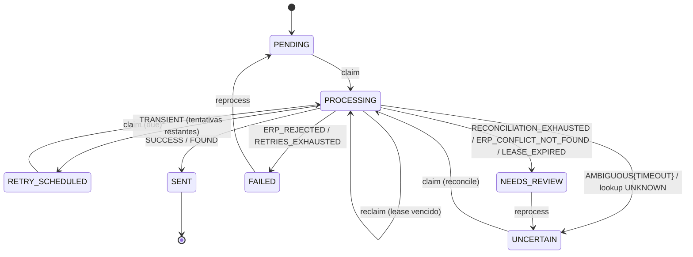
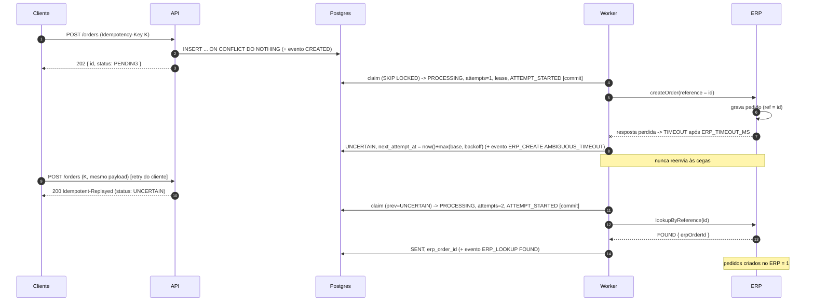

# Plano técnico

Status: **APROVADO** (Fase 2, 2026-11-05), com os ajustes do gate (reprocess atômico, `AMBIGUOUS`/`UNKNOWN`, semântica de `attempts`). Fonte do comportamento: `requirements.md`. ADRs em `docs/adr/`.

## 1. Visão geral

Um único processo Node faz três coisas: (a) a API Fastify grava o pedido e responde `202`; (b) o worker, no mesmo processo, faz polling no Postgres, reivindica pedidos com `FOR UPDATE SKIP LOCKED` + lease e chama o ERP **fora** de transação; (c) cada fato vira uma linha append-only em `order_events`. O Postgres é ao mesmo tempo fonte de verdade, fila e trilha de auditoria.

```
cliente ──POST /orders──▶ Fastify ──INSERT ON CONFLICT──▶ orders + order_events
                                                         ▲   │ claim (SKIP LOCKED + lease)
                                                         │   ▼
                                       resultado guardado   Worker ──createOrder/lookup──▶ ErpClient (Fake)
```

## 2. Estrutura de pastas

```
src/
  config.ts                 # env -> Zod; valida regra do lease (REQ-CONC-06, REQ-SEC-04)
  logger.ts                 # pino + redact (REQ-OBS-05)
  app.ts                    # buildApp({ pool, logger }): Fastify, error handler, rotas
  server.ts                 # main: sobe API + worker; graceful shutdown (migrations são um comando à parte)
  http/
    orders.routes.ts        # POST /orders, GET /orders/:id, POST /orders/:id/reprocess
    health.routes.ts        # GET /health
    correlation.ts          # X-Correlation-Id (REQ-OBS-02)
    errors.ts               # formato { error: { code, message, details? } } (REQ-API-07)
  domain/
    order.ts                # schema Zod do payload, tipos OrderStatus/Order
    state-machine.ts        # TRANSITIONS + assertTransition (REQ-STATE-01/02)
    request-hash.ts         # JSON canônico + SHA-256 (REQ-IDEM-02)
    backoff.ts              # computeDelay(attempt, cfg, random) (REQ-RETRY-01)
  infra/
    db/
      pool.ts               # new Pool(DATABASE_URL)
      migrate.ts            # aplica migrations/*.sql em ordem, tabela schema_migrations
      migrations/001_init.sql
      orders.repo.ts        # TODO o SQL do sistema, funções explícitas
    erp/
      erp-client.ts         # tipos do contrato
      classify.ts           # classifyHttpOutcome (REQ-ERP-07), função pura
      call-with-timeout.ts  # Promise.race com timeout -> AMBIGUOUS{TIMEOUT} / UNKNOWN (REQ-ERP-08)
      fake-erp-client.ts    # cenários + registro + contadores (REQ-ERP-09)
  worker/
    worker.ts               # start/stop/runOnce, loop de polling
    process-order.ts        # decisão de uma tentativa (lookup/create/finalize)
test/
  helpers/                  # db (orders_test, truncate), app, captura de logs, fixtures
  unit/                     # state-machine, backoff, classify, request-hash, config
  integration/              # api, idempotency, concurrency, worker, reprocess, observability
docker-compose.yml          # postgres:16 + init que cria orders_test
.env.example
```

Não há camada de "service" nem repositório genérico: rotas e worker chamam funções de `orders.repo.ts` com nomes de intenção (`insertOrderIdempotent`, `claimNextOrder`, `finalizeAttempt`, `requestReprocess`...).

## 3. Modelo de dados (`001_init.sql`)

```sql
CREATE TABLE orders (
  id                 uuid PRIMARY KEY DEFAULT gen_random_uuid(),
  idempotency_key    text        NOT NULL,
  request_hash       char(64)    NOT NULL,
  payload            jsonb       NOT NULL,
  status             text        NOT NULL DEFAULT 'PENDING',
  attempts           integer     NOT NULL DEFAULT 0 CHECK (attempts >= 0),
  next_attempt_at    timestamptz          DEFAULT now(),
  locked_until       timestamptz,
  lease_token        uuid,
  erp_order_id       text,
  last_error_code    varchar(64),
  last_error_message varchar(200),
  correlation_id     varchar(64) NOT NULL,
  created_at         timestamptz NOT NULL DEFAULT now(),
  updated_at         timestamptz NOT NULL DEFAULT now(),
  CONSTRAINT orders_idempotency_key_uq UNIQUE (idempotency_key),          -- REQ-IDEM-01
  CONSTRAINT orders_status_ck CHECK (status IN ('PENDING','PROCESSING','SENT',
    'RETRY_SCHEDULED','FAILED','UNCERTAIN','NEEDS_REVIEW')),
  CONSTRAINT orders_processing_has_lease_ck CHECK (
    (status = 'PROCESSING') = (lease_token IS NOT NULL AND locked_until IS NOT NULL)),
  CONSTRAINT orders_sent_has_erp_id_ck CHECK (status <> 'SENT' OR erp_order_id IS NOT NULL)
);

-- Claim de pedidos "devidos" (PENDING / RETRY_SCHEDULED / UNCERTAIN). Parcial: estados
-- terminais (SENT, FAILED, NEEDS_REVIEW), que serão a maioria, não entram no índice.
CREATE INDEX orders_due_idx ON orders (next_attempt_at)
  WHERE status IN ('PENDING','RETRY_SCHEDULED','UNCERTAIN');

-- Recuperação de lease vencido (worker que caiu). Pequeno: só pedidos em voo.
CREATE INDEX orders_lease_idx ON orders (locked_until) WHERE status = 'PROCESSING';

CREATE TABLE order_events (
  id             bigserial   PRIMARY KEY,
  order_id       uuid        NOT NULL REFERENCES orders(id),
  type           text        NOT NULL CHECK (type IN ('CREATED','ATTEMPT_STARTED','ERP_CREATE',
                   'ERP_LOOKUP','ATTEMPT_ABANDONED','REPROCESS_REQUESTED')),
  from_status    text,
  to_status      text,                  -- NULL = transição não aplicada (lease perdido)
  attempt        integer,
  outcome        text,                  -- SUCCESS|TRANSIENT_ERROR|PERMANENT_ERROR|AMBIGUOUS_TIMEOUT|AMBIGUOUS_CONFLICT|FOUND|NOT_FOUND|UNKNOWN
  error_code     varchar(64),
  error_message  varchar(200),
  duration_ms    integer,
  reason         varchar(200),          -- só REPROCESS_REQUESTED
  lease_token    uuid,                  -- qual claim produziu o evento
  correlation_id varchar(64) NOT NULL,
  created_at     timestamptz NOT NULL DEFAULT clock_timestamp()
);
CREATE INDEX order_events_order_idx ON order_events (order_id, id);       -- GET /orders/:id
```

Notas:
- `next_attempt_at` nasce `now()` para que `PENDING` use o mesmo índice e a mesma ordenação (FIFO aproximado).
- `clock_timestamp()` nos eventos: vários eventos na mesma transação recebem horários distintos. A ordem canônica é `id`.
- O payload fica em `jsonb` porque o worker precisa dele para enviar ao ERP. Criptografar em repouso é proposta de produção (REQ-SEC-05).
- Os `CHECK`s são uma segunda linha de defesa: mesmo um bug no código não grava `PROCESSING` sem lease nem `SENT` sem `erp_order_id`.

## 4. Máquina de estados



| De \ Para | PENDING | PROCESSING | SENT | RETRY_SCHEDULED | FAILED | UNCERTAIN | NEEDS_REVIEW |
|---|---|---|---|---|---|---|---|
| PENDING | | claim | | | | | |
| PROCESSING | | reclaim | ✔ | ✔ | ✔ | ✔ | ✔ |
| RETRY_SCHEDULED | | claim | | | | | |
| UNCERTAIN | | claim | | | | | |
| FAILED | reprocess | | | | | | |
| NEEDS_REVIEW | | | | | | reprocess | |
| SENT | | | | | | | |

`state-machine.ts` exporta `TRANSITIONS: Record<OrderStatus, readonly OrderStatus[]>` e `assertTransition(from, to)`. O SQL **sempre** inclui `WHERE status = $from`, então a tabela em código documenta e o banco garante.

`last_error_code` por destino: `FAILED` → `ERP_REJECTED` | `RETRIES_EXHAUSTED`; `UNCERTAIN` → `ERP_TIMEOUT` | `ERP_LOOKUP_UNKNOWN`; `NEEDS_REVIEW` → `RECONCILIATION_EXHAUSTED` | `ERP_CONFLICT_NOT_FOUND` | `LEASE_EXPIRED`; `RETRY_SCHEDULED` → código do ERP (ex.: `ERP_503`).

## 5. Fluxo do POST /orders (idempotência)

1. `correlation.ts` define `correlationId` (REQ-OBS-02).
2. Fastify rejeita body > 32 KB (`bodyLimit`, 413) e content-type ≠ JSON (415). O error handler traduz para o formato padrão.
3. Valida `Idempotency-Key` (regex) e o body com Zod `.strict()`: 400.
4. `request_hash = sha256(canonicalJson(parsedBody))`, com chaves ordenadas recursivamente sobre o objeto **já validado**.
5. Uma única instrução, atômica:
   ```sql
   WITH ins AS (
     INSERT INTO orders (idempotency_key, request_hash, payload, correlation_id)
     VALUES ($1, $2, $3, $4)
     ON CONFLICT (idempotency_key) DO NOTHING
     RETURNING id, status, created_at, correlation_id
   ), ev AS (
     INSERT INTO order_events (order_id, type, to_status, correlation_id)
     SELECT id, 'CREATED', 'PENDING', correlation_id FROM ins
   )
   SELECT id, status, created_at FROM ins;
   ```
6. Retornou linha → `202` + `Location`. Não retornou → `SELECT id, status, created_at, request_hash FROM orders WHERE idempotency_key = $1`: hash igual → `200` + `Idempotent-Replayed: true`; diferente → `422`.

**Por que funciona sob concorrência:** em READ COMMITTED, um `INSERT ... ON CONFLICT DO NOTHING` que colide com uma inserção **ainda não confirmada** espera por ela. Se ela confirmar, o nosso não insere; se abortar, o nosso insere. O `SELECT` seguinte é outra instrução, com snapshot novo, e enxerga a linha confirmada. Não existe janela "SELECT-then-INSERT".

## 6. Worker: claim com lease

Configuração: `WORKER_POLL_INTERVAL_MS` (1000), `WORKER_BATCH_SIZE` (10), `LEASE_MS` (30000).

`runOnce()`: repete até `WORKER_BATCH_SIZE` vezes {`claimNextOrder()`; se vazio, para; `processClaimed()`} e retorna quantos processou. O loop chama `runOnce()` e, se ele retornar 0, dorme `POLL_INTERVAL` (sono interrompível no shutdown). Os testes chamam `runOnce()` diretamente.

**Claim** (uma transação curta, sem I/O externo):
```sql
BEGIN;
WITH next AS (
  SELECT id, status AS prev_status
  FROM orders
  WHERE (status IN ('PENDING','RETRY_SCHEDULED','UNCERTAIN') AND next_attempt_at <= now())
     OR (status = 'PROCESSING' AND locked_until < now())
  ORDER BY COALESCE(next_attempt_at, locked_until)
  LIMIT 1
  FOR UPDATE SKIP LOCKED
)
UPDATE orders o
SET status = 'PROCESSING', attempts = o.attempts + 1,
    lease_token = gen_random_uuid(),
    locked_until = now() + make_interval(secs => $1 / 1000.0),
    next_attempt_at = NULL, updated_at = now()
FROM next WHERE o.id = next.id
RETURNING o.id, o.payload, o.attempts, o.lease_token, o.correlation_id, next.prev_status;

-- Caso A (normal): inicia a tentativa
INSERT INTO order_events (order_id, type, from_status, to_status, attempt, lease_token, correlation_id)
VALUES ($id, 'ATTEMPT_STARTED', $prev_status, 'PROCESSING', $attempts, $lease_token, $corr);

-- Caso B (prev_status = 'PROCESSING' AND attempts > MAX_ATTEMPTS): abandona, sem tentativa (REQ-RETRY-05)
UPDATE orders SET status = 'NEEDS_REVIEW', last_error_code = 'LEASE_EXPIRED', last_error_message = ...,
       lease_token = NULL, locked_until = NULL, updated_at = now()
WHERE id = $id AND lease_token = $lease_token;
INSERT INTO order_events (..., type, from_status, to_status, attempt, error_code, ...)
VALUES (..., 'ATTEMPT_ABANDONED', 'PROCESSING', 'NEEDS_REVIEW', $attempts, 'LEASE_EXPIRED', ...);
COMMIT;      -- caso A: só depois disso o ERP é chamado (REQ-ERP-01). Caso B: claimNextOrder devolve
             -- { kind: 'ABANDONED' } e o worker segue para o próximo pedido sem tocar no ERP.
```
O incremento de `attempts` no claim é incondicional, numa única instrução e sem ramificação no SQL. Por isso `attempts = MAX_ATTEMPTS + 1` é o valor esperado no caso B: ele registra um claim além do limite, não uma chamada ao ERP. A decisão do caso B fica **dentro** da transação do claim, então nenhum lease utilizável chega ao `process-order.ts`.
- `SKIP LOCKED`: dois workers nunca reivindicam a mesma linha nem bloqueiam um ao outro (REQ-CONC-03).
- O `WHERE` usa `now()` do banco: sem divergência de relógio entre instâncias (P-04).
- O `OR` é servido por um BitmapOr sobre os dois índices parciais.
- `lease_token` novo em cada claim funciona como *fencing token* (REQ-CONC-04).

**Finalização** (transação curta):
```sql
UPDATE orders SET status = $to, erp_order_id = ..., last_error_code = ..., last_error_message = ...,
       next_attempt_at = $next, lease_token = NULL, locked_until = NULL, updated_at = now()
WHERE id = $id AND status = 'PROCESSING' AND lease_token = $token;
-- rowCount = 1 -> INSERT evento (from=PROCESSING, to=$to)
-- rowCount = 0 -> INSERT evento (from=PROCESSING, to=NULL, error_code='LEASE_LOST') + log warn
```
Chamadas intermediárias ao ERP (consulta `NOT_FOUND` antes de reenviar; `AMBIGUOUS{CONFLICT}` antes da consulta) gravam o evento **imediatamente** com `from = to = PROCESSING`, para que um crash no meio da tentativa não apague o fato de que o ERP foi chamado.

## 6b. Reprocess (atômico)

```sql
WITH upd AS (
  UPDATE orders
  SET status = CASE status WHEN 'FAILED' THEN 'PENDING' ELSE 'UNCERTAIN' END,
      attempts = 0, last_error_code = NULL, last_error_message = NULL,
      next_attempt_at = now(), updated_at = now()
  WHERE id = $1 AND status IN ('FAILED','NEEDS_REVIEW')
  RETURNING id, status, correlation_id
)
INSERT INTO order_events (order_id, type, from_status, to_status, reason, correlation_id)
SELECT id, 'REPROCESS_REQUESTED',
       CASE status WHEN 'PENDING' THEN 'FAILED' ELSE 'NEEDS_REVIEW' END, status, $2, $3
FROM upd
RETURNING order_id, to_status;
```
0 linhas → `SELECT status FROM orders WHERE id = $1` só para responder `404` ou `409 { currentStatus }`. A decisão foi do `UPDATE`. Concorrência: em READ COMMITTED, o segundo `UPDATE` espera o lock da linha, reavalia o `WHERE` sobre a versão confirmada (`PENDING`) e afeta 0 linhas. O `from_status` é derivado do novo status, porque o mapeamento é 1:1.

## 7. Decisão de uma tentativa (`process-order.ts`)

```
(caso B do claim, REQ-RETRY-05, já foi resolvido antes daqui: nunca chega a este fluxo)
claimed (prevStatus, attempts)
├─ ambíguo = prevStatus ∈ {UNCERTAIN, PROCESSING}                                                [REQ-ERP-06, REQ-CONC-05]
│   └─ lookup(id): FOUND ─▶ SENT | NOT_FOUND ─▶ segue p/ create | UNKNOWN ─▶ ambiguousFail
└─ create(id, payload):                                                                           [REQ-IDEM-04]
    SUCCESS                ─▶ SENT                                                                [REQ-ERP-02]
    PERMANENT_ERROR        ─▶ FAILED (ERP_REJECTED)                                               [REQ-ERP-03]
    TRANSIENT_ERROR        ─▶ attempts < MAX ? RETRY_SCHEDULED(backoff) : FAILED(RETRIES_EXHAUSTED) [REQ-RETRY-02/03]
    AMBIGUOUS{TIMEOUT}     ─▶ ambiguousFail                                                       [REQ-ERP-05]
    AMBIGUOUS{CONFLICT}    ─▶ lookup: FOUND ─▶ SENT | NOT_FOUND ─▶ NEEDS_REVIEW(ERP_CONFLICT_NOT_FOUND), imediato
                                     | UNKNOWN ─▶ ambiguousFail                                   [REQ-ERP-11]
ambiguousFail: attempts < MAX ? UNCERTAIN(max(base, backoff)) : NEEDS_REVIEW(RECONCILIATION_EXHAUSTED) [REQ-RETRY-04]
```
A árvore é escrita como um `switch` exaustivo sobre `result.kind` (o TypeScript acusa caso esquecido via `never`).

Toda chamada ao ERP passa por `callWithTimeout(fn, ms)` (Promise.race com `setTimeout`, limpo no `finally`) e é cronometrada com `performance.now()` para gravar `duration_ms`.

## 8. Política de retry

| Variável | Padrão | Uso |
|---|---|---|
| `MAX_ATTEMPTS` | 5 | limite de tentativas (transitório e ambíguo) |
| `RETRY_BASE_DELAY_MS` | 1000 | base do backoff e piso da reconciliação |
| `RETRY_MAX_DELAY_MS` | 60000 | teto do backoff |
| `ERP_TIMEOUT_MS` | 5000 | timeout de `createOrder` |
| `ERP_LOOKUP_TIMEOUT_MS` | 3000 | timeout de `lookupByReference` |
| `LEASE_MS` | 30000 | precisa ser > 5000 + 2·3000 + 5000 = 16000 (REQ-CONC-06) |
| `WORKER_POLL_INTERVAL_MS` | 1000 | espera quando não há trabalho |
| `WORKER_BATCH_SIZE` | 10 | claims por `runOnce` |
| `WORKER_ENABLED` | true | desliga o worker (ex.: rodar só a API) |

`computeDelay(attempt, { base, max }, random = Math.random) = floor(random() * min(max, base * 2 ** (attempt - 1)))` (full jitter: espalha os retries e evita rajadas sincronizadas contra um ERP que está se recuperando). Para ambíguo: `max(base, computeDelay(...))`. Com os padrões, o pior caso acumulado até esgotar fica em cerca de 15 s de atraso esperado, em escala de segundos (não de horas), o que é adequado para demonstração. Em produção, os valores seriam calibrados pelo SLA do ERP.

## 9. Contrato do ErpClient

```ts
export type ErpError = { code: string; message: string };   // code ≤ 64, message ≤ 200 (truncada na borda)

export type CreateOrderResult =
  | { kind: 'SUCCESS'; erpOrderId: string }
  | ({ kind: 'TRANSIENT_ERROR' } & ErpError)
  | ({ kind: 'PERMANENT_ERROR' } & ErpError)
  | { kind: 'AMBIGUOUS'; cause: 'TIMEOUT' | 'CONFLICT' };

export type LookupResult =
  | { kind: 'FOUND'; erpOrderId: string }
  | { kind: 'NOT_FOUND' }
  | ({ kind: 'UNKNOWN' } & ErpError);          // timeout, 5xx, conexão: a consulta não respondeu

export interface ErpClient {
  createOrder(reference: string, payload: OrderPayload): Promise<CreateOrderResult>;
  lookupByReference(reference: string): Promise<LookupResult>;
}
```
`classify.ts` tem duas funções puras: `classifyCreate({ status?, errorCode? })` → `kind` (+ `cause`) e `classifyLookup(...)` → `FOUND | NOT_FOUND | UNKNOWN`, com `errorCode ∈ 'ECONNREFUSED'|'ECONNRESET'|'TIMEOUT'`. O fake as usa para converter status simulados, e elas ficam prontas para um `HttpErpClient` futuro (REQ-ERP-10).

**FakeErpClient**
- `scenarios: CreateScenario[]` consumidos em fila, um por chamada `createOrder`; o último se repete. Cenários: `success`, `transient` (503), `permanent` (422), `timeout` (nada gravado), `processed_then_timeout` (grava e retorna `AMBIGUOUS{TIMEOUT}`), `conflict_found` (registra a referência se ausente e retorna 409), `conflict_not_found` (409 sem registrar).
- `lookupScenarios: LookupScenario[]`, no mesmo esquema de fila: `auto` (padrão, responde pelo registro) ou `unknown` (503 na consulta).
- `registry: Map<reference, erpOrderId>`.
- Contadores: `createCalls`, `lookupCalls`, `createdCount` (= `registry.size`, a métrica de "sem duplicidade").
- `hooks.beforeCreateResponds?: (reference) => Promise<void>`: permite ao teste inspecionar o banco durante a chamada (REQ-ERP-01) ou intercalar outro worker (REQ-CONC-04), de forma determinística.
- `hang()`: a próxima chamada só resolve quando o teste liberar (REQ-ERP-08, com `vi.useFakeTimers`).

## 10. Diagrama: ERP processa e dá timeout



## 11. Observabilidade e segurança

- `logger.ts`: pino com `redact: { paths: [...], censor: '[REDACTED]' }` cobrindo `payload`, `body`, `customer`, `*.customer`, `*.payload`, `*.document`, `*.email`, `*.name`, `notes`, `*.notes`, `reason`, `req.headers.authorization`, `req.headers.cookie`. O redact é uma rede de segurança; a regra principal é **não passar** esses objetos ao logger.
- Fastify: `disableRequestLogging: true` e um hook `onResponse` próprio que loga `method`, `route`, `statusCode`, `durationMs` e `correlationId`, sem body e sem query string.
- Logs do worker usam `logger.child({ correlationId, orderId })` e acrescentam `attempt`, `status` e `outcome`.
- O error handler nunca devolve `err.message` de erros não mapeados (REQ-API-07). Erros de Zod viram `details: [{ path, message }]` sem o valor recebido (REQ-API-02).
- `config.ts`: em caso de erro, informa só o **nome** da variável (REQ-SEC-04).

## 12. Graceful shutdown (Q-11)

`SIGTERM`/`SIGINT` → `worker.stop()` (para de reivindicar e aguarda a tentativa em curso) → `app.close()` → `pool.end()`. Se o processo morrer mesmo assim, o lease devolve o pedido, que é tratado como ambíguo.

## 13. Estratégia de testes

Infra: `docker compose up -d db` sobe o Postgres com `orders_dev` e `orders_test` (script de init). Antes da suíte, o `globalSetup` do Vitest aplica as migrations em `orders_test` e **aborta se o nome do banco não terminar em `_test`**. `beforeEach` faz `TRUNCATE order_events, orders`. Arquivos de integração rodam sequencialmente (`fileParallelism: false`), pois compartilham o banco. Concorrência é testada **dentro** de cada teste.

Determinismo: nada de `sleep`. O tempo é manipulado por helpers SQL (`makeDue(id)` → `next_attempt_at = now()`; `expireLease(id)` → `locked_until = now() - interval '1s'`) e por `vi.useFakeTimers` só no teste de timeout. O `random` do backoff é injetado.

| Arquivo | Teste (resumo) | REQ-IDs |
|---|---|---|
| unit/state-machine.test.ts | todos os pares válidos aceitos, inválidos rejeitados | STATE-01, STATE-02 |
| unit/backoff.test.ts | random=1 → 1000/2000/4000/60000; random=0 → 0; piso ambíguo | RETRY-01 |
| unit/classify.test.ts | tabela de status/erros → kind/cause | ERP-07 |
| unit/request-hash.test.ts | ordem de chaves não altera hash; valor altera | IDEM-02 |
| unit/config.test.ts | lease curto rejeitado; var ausente cita nome, não valor | CONC-06, SEC-04 |
| unit/call-with-timeout.test.ts | chamada pendurada → AMBIGUOUS{TIMEOUT} / UNKNOWN (fake timers) | ERP-08 |
| unit/fake-erp.test.ts | cenários, registro, contadores, conflict | ERP-09 |
| integration/api.test.ts | 202 + Location; 400 schema/sem valor ecoado; 400 chave; 404; 413; 415; 500 sem stack; health 200/503; GET sem payload | API-01..07, SEC-01..03 |
| integration/idempotency.test.ts | **(2)** mesma chave + payload diferente → 422; replay → 200 estado atual; chaves reordenadas | IDEM-01..03 |
| integration/concurrency.test.ts | **(1)** 20 POST concorrentes → 1 pedido; P1/P2 concorrentes; **(6)** dois workers, 1 chamada; SKIP LOCKED com transação segurada | CONC-01..03 |
| integration/worker-outcomes.test.ts | success; **(3)** permanent → FAILED sem retry; **(4)** transient ×2 → SENT, createdCount=1; esgotado → RETRIES_EXHAUSTED; due no futuro não é reivindicado; estado persistido antes do ERP; referência estável | ERP-01..04, RETRY-02/03/06, IDEM-04, STATE-04 |
| integration/ambiguity.test.ts | **(5)** processed_then_timeout → SENT, createdCount=1; timeout sem gravação → lookup NOT_FOUND → create; lookup timeout não reenvia; esgotado → NEEDS_REVIEW; conflict_found → SENT; conflict_not_found → NEEDS_REVIEW imediato; conflict + lookup unknown → UNCERTAIN | ERP-05, ERP-06, ERP-11, RETRY-04 |
| integration/lease.test.ts | **(7)** crash simulado + lease vencido → recuperado com lookup; fencing: A perde lease, gravação 0 linhas + evento LEASE_LOST; reclaim com attempts=MAX → NEEDS_REVIEW, attempts=MAX+1, ATTEMPT_ABANDONED, sem ATTEMPT_STARTED, 0 chamadas ERP; attempts=MAX-1 → tentativa normal | CONC-04, CONC-05, RETRY-05, STATE-03 |
| integration/reprocess.test.ts | FAILED → PENDING com reason; NEEDS_REVIEW → UNCERTAIN → lookup → SENT; estados proibidos → 409; N=10 concorrentes → 1×202, 9×409, 1 evento | RETRY-07, RETRY-08, STATE-03 |
| integration/observability.test.ts | **(8)** marcadores sensíveis ausentes dos logs em todos os cenários; redact de `{payload}`; campos obrigatórios nos logs do worker; correlation id propagado; sequência de eventos; truncamento de 200 chars | OBS-01..05 |

Os números em negrito são os 8 testes obrigatórios.

Na Fase 3, os arquivos foram divididos por tarefa, e `tasks.md` é a fonte dos nomes finais: `api.test.ts` virou `http-base.test.ts` (T-03) + `orders-api.test.ts` (T-04); `concurrency.test.ts` virou `concurrency-post.test.ts` (T-05) + `concurrency-worker.test.ts` (T-08); o retry transitório saiu de `worker-outcomes` para `retry.test.ts` (T-09); a concorrência do reprocess foi para `concurrency-reprocess.test.ts` (T-12); e entrou `schema.test.ts` (T-02). Todo teste de concorrência segue o padrão `concurrency-*.test.ts` para entrar no `test:stress`.

## 14. Fora do plano (de propósito)

ORM, injeção de dependência via container, filas, Redis, circuit breaker, OpenAPI/Swagger, métricas. O motivo de cada um está nos ADRs e nos Não-objetivos.
